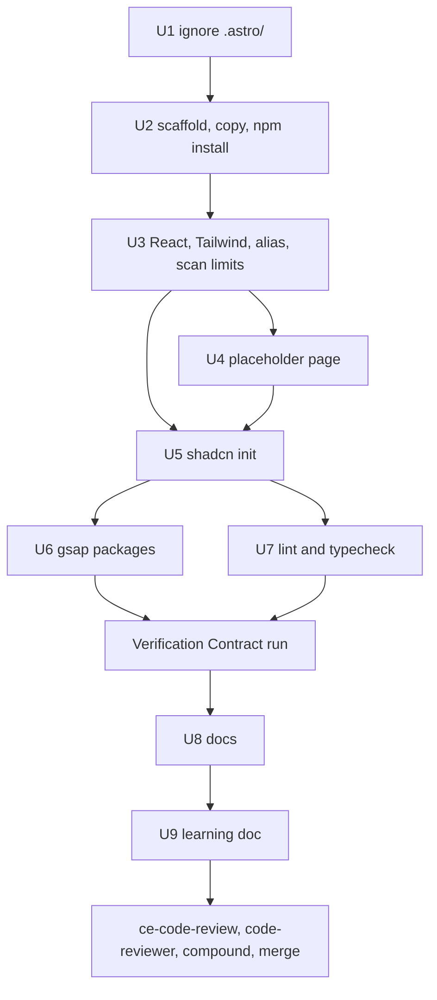
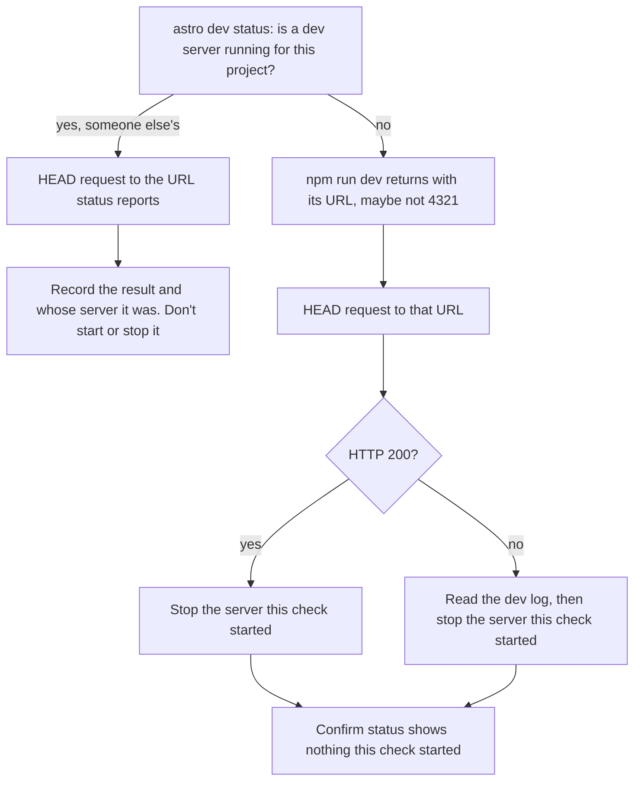

# Astro + React App Setup - Plan

**Task:** `06_react_app_setup` in `document/task/task.md`. Its steps there are the scope; `CLAUDE.md` wins over this plan wherever they differ.

---

## Goal Capsule

- **Objective:** The owner can run the Sanjivani Clinic site on their own machine (`npm install`, `npm run dev`) and see a placeholder page. Every later UI task then starts from a base where lint, type check and build already pass and leave git clean.
- **Means:** Astro 7's minimal template, created in a scratch folder and copied in, plus React, Tailwind v4, shadcn init and the GSAP packages, with ESLint and `astro check` as the gates (KTD1, KTD4, KTD6, KTD8).
- **Authority:** `CLAUDE.md` first, then the task 06 steps in `document/task/task.md`, then this plan.
- **Stop and ask the owner if:**
  - an install only works with `--force` or `--legacy-peer-deps`;
  - a copy would replace `readme.md`, `CLAUDE.md`, `.gitignore` or anything in `.claude/`;
  - shadcn needs a third-party registry, a URL, `--overwrite` or `init --force`;
  - anything needs a global install, a push, a PR or a paid service;
  - the Compound Engineering pin in `~/.claude/plugins/installed_plugins.json` no longer matches `786ac01…`;
  - `@latest` resolves to a different major version than this plan names (Astro 7, shadcn 4, Tailwind 4, ESLint 10).
- **Execution profile:** almost all config and generated files. Prove each unit with an install or runtime smoke check, not unit tests. There is no test framework yet, and adding one is out of scope.
- **Who finishes:** the main session builds and commits on the `06_react_app_setup` branch, in small Conventional Commits. Nothing is pushed and no PR is opened. Review, compound and merge follow the `CLAUDE.md` task workflow (steps 7 to 9).

---

## Product Contract

### Summary

Set up the app at the repo root: Astro 7 with React islands and TypeScript, Tailwind CSS v4, shadcn/ui initialised with Base UI, and gsap with `@gsap/react` installed. The starter page becomes a one-heading placeholder. `npm run lint`, `npm run typecheck` and `npm run build` must pass and leave git clean. The docs and a learning doc then describe the app as it now exists.

### Problem Frame

The repo has its rules, skills, agents and workflow, but no app. Every backlog task from 07 on (design system, layout, pages, booking form) needs a working project to build on. The ui-engineer agent stops when `package.json` or `components.json` is missing at the root.

Three things make this harder than a plain `npm create astro`:

- The repo root is not empty, and this Mac's disk ignores letter case, so the template's `README.md` would overwrite our `readme.md`.
- The repo contains third-party skill files (`.tsx`, `.mjs`, CSV full of Tailwind classes) that the new tools would lint, type-check or scan unless told not to.
- The newest TypeScript (7.0) is ahead of the lint and check tools.

### Requirements

**App foundation**

- R1. An Astro 7 app sits at the repo root, made from the minimal template. Its package is named `sanjivani-clinic` and marked `private`.
- R2. React islands, Tailwind CSS v4 and the `@/*` path alias work, following the shadcn Astro guide.
- R3. The starter page is replaced by a placeholder: a "Sanjivani Clinic" heading and one line of text. Nothing else.
- R4. shadcn is initialised with CSS variables and no components, and `shadcn info --json` finds `components.json`.
- R5. `gsap` and `@gsap/react` are installed, with no animation code.

**Quality gates**

- R6. `npm run lint` (eslint-plugin-astro + typescript-eslint) and `npm run typecheck` (`astro check`) exist, and both pass, together with `npm run build`.
- R7. The dev server serves the placeholder page with HTTP 200.

**Repo safety**

- R8. No scaffold file replaces `readme.md`, `CLAUDE.md`, `.gitignore` (or its comments) or anything in `.claude/`. A scaffold `AGENTS.md` is read before any decision about keeping it.
- R9. No generated folder (`node_modules/`, `dist/`, `.astro/`) is tracked, and running the npm scripts leaves `git status` unchanged.
- R10. Lint, type check and Tailwind's class scan ignore `.claude/` and `document/`.

**Docs and teaching**

- R11. `CLAUDE.md`, `readme.md`, `document/skills/skills.md` and the task.md backlog describe the app as it now exists: the stage, the stack, the commands and how to run it locally.
- R12. The learning doc `document/learning/06_react_app_setup.md` teaches Astro basics and islands, the folder layout, Tailwind, what shadcn init changed, `package.json` vs `package-lock.json` and the npm scripts. It shows only output that was really printed.

### Key Decisions

- **The placeholder page renders no React component.** The checks prove React is configured and builds, but no island runs in the browser until the first UI task. Governs R3. (session-settled: user-approved — chosen over adding a small test island: the task says "nothing else")
- **Astro's anonymous telemetry stays on.** The learning doc explains what it is and how to turn it off. Governs R12. (session-settled: user-directed — chosen over `npx astro telemetry disable`: that writes a user-level setting outside the repo, and the owner chose not to now)

### Success Criteria

- From the committed lockfile, `npm ci` followed by lint, typecheck and build passes, and git shows no change afterwards.
- The ui-engineer agent's first check (both `package.json` and `components.json` at the root) passes.
- The built CSS holds no class that exists only in `.claude/` or `document/`.

### Scope Boundaries

- No features, no shadcn components, no animation code and no layout shell. The layout is task 08.
- No hosting setup: no Vercel adapter and no `.vercel/` ignore line. Both belong to task 23.
- No test framework.
- The agent files in `.claude/agents/` don't change. Their jobs stay the same, as long as the scripts are named exactly `lint`, `typecheck` and `build`.
- Considered and not built:
  - **`engine-strict` in `.npmrc`.** npm already warns on an old Node because Astro declares `node >=22.23.4`. Revisit if someone installs on an old Node and misses the warning.
  - **Typed lint rules** (`recommendedTypeChecked`). They have open bugs with Astro files and slow lint down. Revisit when eslint-plugin-astro supports them.
  - **Prettier.** Nobody asked for it, and formatting can come with the first UI task.

#### Deferred to Follow-Up Work

- Accessibility lint rules (`eslint-plugin-jsx-a11y`) once they support ESLint 10 (6.10.2 requires ESLint 9 or older), and React hooks rules (`eslint-plugin-react-hooks`), with the first UI task. Add as backlog notes.
- A `.nvmrc` so fnm picks Node 24 on its own. Backlog note.
- Geist, the `nova` preset's font, has no Devanagari letters, so Hindi and Marathi text would fall back to a system font. Task 07 must pick a font that covers them. Backlog note on 07.
- `design-system/` (written by ui-ux-pro-max in task 07) must stay out of lint and the Tailwind scan. This is already covered by KTD5, but it is worth a line on backlog 07.
- Stale notes left for their own task: the `skills@1.5.18` pin note in `CLAUDE.md` and `readme.md` ("while Node is below 22.20"), and the `.next/` lines kept from an earlier stack guess.
- The backlog's "open decision" paragraph about keeping `main` in step with GitHub is out of date. The owner's sync commits `cd138bb` and `8b057f7` already joined the two. That paragraph is the owner's text, so this task only points it out to the owner.
- code-reviewer reads "every changed file in full", and the lockfile is about 10,000 lines. Changing the reviewer is its own task. For now the learning doc gives the lockfile checks (KTD10), so the reviewer can skim it.

---

## Planning Contract

### Key Technical Decisions

- KTD1. **Scaffold in a scratch folder named `sanjivani-clinic` outside the repo, then copy from a named list.**
  - create-astro refuses a non-empty root: with `--yes` it creates a random sub-folder. It also writes `README.md`, which would replace `readme.md` on this disk.
  - Run it from inside the scratch area with a **relative** target (`./sanjivani-clinic`). create-astro takes the package name from the last folder name only for a relative target. An absolute path is turned into one long name that holds the owner's username and the session path, and that name would land in git history.
  - Flags: `--template minimal --no-install --no-git --skip-houston --yes`, adjusted to what `--help` shows. Do **not** pass `--no-ai`: the task asks us to read any `AGENTS.md` before deciding, so let create-astro write it in the scratch folder.
  - Before copying, run a dry-run collision check that ignores letter case.
  - Copy `package.json`, `astro.config.mjs`, `tsconfig.json`, `src/`, `public/` and `.vscode/`.
  - Copy `AGENTS.md` only if KTD12 keeps it.
  - Never copy `README.md`, `.gitignore`, `node_modules/`, `.git/`, `CLAUDE.md` or `.claude/`. The scaffold's `.gitignore` lines are merged by hand instead (U2).
  - `"private": true` is added back, because create-astro removes it.
- KTD2. **Order matters.** First add `.astro/` to `.gitignore`. Then copy the scaffold, then `npm install`, then `astro add react tailwind`.
  - `.astro/` is created by the first `astro` command, and an unignored `.astro/` would break the review's before-and-after `git status` check.
  - `astro add` picks npm from the lockfile. Without one it installs nothing and skips `global.css`.
- KTD3. **The `@/*` alias uses `paths` with no `baseUrl`.** The shadcn Astro guide shows `"baseUrl": "."`, but TypeScript 6 marks `baseUrl` as deprecated (error TS5101 in `tsc` and editors). `paths` alone has worked since TS 4.1. shadcn's own Astro template does the same, and shadcn init accepts it. The learning doc names this as a deliberate change from the guide.
- KTD4. **TypeScript is pinned to `~6.0.3`, installed together with `@astrojs/check`.** TypeScript 7.0.2 is `latest`. Astro 7.4's `astro check` refuses TS 7, and typescript-eslint 8.72 supports only `<6.1.0`. The tilde allows 6.0.x bug fixes but never 6.1. Installing both packages explicitly stops `astro check` from offering to install `typescript@latest`. (session-settled: user-approved — chosen over TypeScript 7.0: the check and lint tools don't support it yet)
- KTD5. **Keep the tools out of `.claude/` and `document/`.** (session-settled: user-approved — chosen over the tools' defaults: they would lint, type-check or scan third-party skill files we must never edit)
  - **Tailwind:** set the base path on the import line in `src/styles/global.css` to that file's parent folder, `source("../")`, which means "scan `src/` only". It is an allowlist, so it also covers future root folders like `design-system/`, and shadcn init keeps the line.
  - **ESLint:** global ignores for `dist/`, `.astro/`, `.claude/`, `document/`, `.compound-engineering/`, `.worktrees/`, `.context/`, `.vercel/` and `design-system/`. ESLint 10 lints dot-folders and doesn't read `.gitignore`.
  - **TypeScript:** add `.claude` and `document` to `tsconfig.json`'s `exclude`, keeping `dist`. TS globs already skip dot-folders, but the list makes the rule visible.
- KTD6. **shadcn init with `--base base --preset nova`, after reading `init --help`.** `--defaults` means a Next.js template, and `-t astro` also adds a Button, so neither fits. `nova` is the first preset (Lucide icons, Geist font, neutral colours). Task 07 can change the preset later. Read every file init writes or changes, as `CLAUDE.md` requires. (session-settled: user-directed — chosen over Radix UI and React Aria: Base UI is shadcn's recommended default and what the installed shadcn skill uses)
- KTD7. **The placeholder page imports `global.css` itself.** `astro add tailwind` creates the stylesheet but imports it nowhere. A shared layout is task 08's job, so this task adds no layout file.
- KTD8. **ESLint 10 flat config with `defineConfig` and `globalIgnores` from `eslint/config`.**
  - Order: `@eslint/js` recommended, then typescript-eslint recommended, then eslint-plugin-astro recommended. typescript-eslint must come before astro, so astro's parser wins for `.astro` files.
  - `@eslint/js` is ESLint's own core rule set, which ESLint 10 no longer bundles. It is not a third plugin.
  - Turn `no-undef` off for `.astro` files, as typescript-eslint advises for TypeScript code, because TypeScript already checks names.
  - No type-aware rules. (session-settled: user-approved — chosen over adding jsx-a11y and react-hooks now: only the two plugins the task names)
- KTD9. **The script names are fixed: `dev`, `build`, `preview`, `astro`, `lint` (`eslint .`) and `typecheck` (`astro check`).** `build` stays plain `astro build`, and `typecheck` is a separate gate, because the agents call `lint`, `typecheck` and `build` by name.
- KTD10. **Install with each tool's `@latest` (as the task steps say), then record what it resolved to.**
  - `package.json` keeps npm's default `^` ranges, except the TypeScript pin. The lockfile pins exact versions.
  - Each `package.json` change is committed with its `package-lock.json` change.
  - Check that every `resolved` URL in the lockfile points at `registry.npmjs.org`.
  - Don't approve npm 11's `install-scripts` prompt for `fsevents`. It is harmless, and approving it writes into `package.json`.
- KTD11. **The dev-server check uses Astro 7's agent mode, and never touches a server Claude didn't start.**
  - When Astro detects Claude Code (`CLAUDECODE=1`), `npm run dev` starts a detached server, prints its URL and returns.
  - First ask Astro whether a dev server is already running for this project (`astro dev status`). The owner's own terminal server writes the same lock file. While it runs, a second `npm run dev` only reports it, and `astro dev stop` would kill it.
  - **If one is running:** send the HTTP request to the URL `status` reports. It serves the same working tree, so a 200 still proves R7. Neither start nor stop it, and record that the 200 came from that server.
  - **If none is running:** start one, read the URL from its output, and never assume 4321. Another program on 4321 just moves Astro to the next port. Send the request, then stop the server this check started.
  - The clean-install check (`npm ci` deletes `node_modules/`) also runs only while no dev server for this project is running.
  - The learning doc explains that the owner's own terminal runs the server in the foreground at `http://localhost:4321`, stopped with Ctrl+C.
- KTD12. **The `AGENTS.md` decision is made after reading it, by one test.** Keep it only if it adds guidance that `CLAUDE.md` lacks and contradicts none of `CLAUDE.md` or KTD11's stop rule (`document/solutions/workflow-issues/check-new-steps-against-claude-md.md`). For example, an unguarded "manage the server with `astro dev stop`" fails the test. If kept, U2 copies it and `CLAUDE.md` imports it with an `@AGENTS.md` line. Either way, `CLAUDE.md` gets a short Commands section with the dev-server commands, because ui-engineer runs a dev server to check widths. That section states the KTD11 rule: check `astro dev status` first, and run `astro dev stop` only for a server this session's own `npm run dev` started. `astro dev stop` stops any dev server for this project, including the owner's.

### High-Level Technical Design

Order of the work. Each box lands as its own small commit, or a few, on the task branch.

The dev-server check (KTD11):

---

## Implementation Units

### U1. Ignore Astro's generated folder

- **Goal:** git never sees `.astro/` before the first `astro` command creates it.
- **Requirements:** R9
- **Dependencies:** none
- **Files:** `.gitignore`
- **Approach:** add `.astro/` to the existing "Build output" group, matching the file's style (a comment line saying why, then the entries). Change no other line. It lands as its own commit (KTD2).
- **Test expectation:** none -- one ignore line. Proven in the Verification Contract by `git status` after build and dev.
- **Verification:** `git check-ignore .astro/x` names the new line.

### U2. Scaffold, copy and install

- **Goal:** the minimal Astro template's files are in the repo root, with our own files untouched and a committed lockfile.
- **Requirements:** R1, R8
- **Dependencies:** U1
- **Files:** `package.json`, `package-lock.json`, `astro.config.mjs`, `tsconfig.json`, `src/pages/index.astro`, `public/favicon.ico`, `public/favicon.svg`, `.vscode/extensions.json`, `.vscode/launch.json`, `.gitignore`, and `AGENTS.md` only if KTD12 keeps it (the exact list is whatever the template really makes, minus the KTD1 exclusions)
- **Approach:**
  1. Read `npm create astro@latest -- --help` and adjust the KTD1 flags to what it really offers.
  2. From inside the scratch area, scaffold into the relative target `./sanjivani-clinic` (KTD1), outside the repo.
  3. Read every file it made, including any `AGENTS.md`. Check that `package.json`'s `name` is `sanjivani-clinic` before anything is copied. Apply the KTD12 test to `AGENTS.md`, and record the verdict for U8 and the learning doc.
  4. Compare the scaffold's `.gitignore` with ours. Add any line ours lacks to the matching group, keeping our comments. U1 already added `.astro/`. Record which lines were added, or that none were, for the learning doc.
  5. Run the case-insensitive collision check and read its output.
  6. Copy the KTD1 allowlist, plus `AGENTS.md` if KTD12 kept it. Commit the untouched scaffold first, so the history shows exactly what the template gave us.
  7. Restore `"private": true`.
  8. Run `npm install` and commit `package.json` with `package-lock.json`.
- **Patterns to follow:** commit `90cac07`, which records a pinned version in its body. Do the same with the resolved create-astro and Astro versions.
- **Test expectation:** none -- generated scaffold.
- **Verification:**
  - `git status` shows only new files, plus `.gitignore` (U1's `.astro/` line, and any merged scaffold lines).
  - `readme.md`, `CLAUDE.md` and `.claude/settings.json` have no diff.
  - `package.json` names `sanjivani-clinic`, is `private`, and holds no scratch-folder path.
  - `npm ls astro` shows a 7.x version.

### U3. React, Tailwind, the alias and the scan limits

- **Goal:** React islands and Tailwind v4 are wired in, `@/` resolves to `src/`, and none of the tools reach `.claude/` or `document/`.
- **Requirements:** R2, R10
- **Dependencies:** U2
- **Files:** `astro.config.mjs`, `tsconfig.json`, `src/styles/global.css`, `package.json`, `package-lock.json`
- **Approach:**
  - `npx astro add react tailwind --yes`. It adds `@astrojs/react`, React 19, `@tailwindcss/vite` and `tailwindcss`, and it rewrites `astro.config.mjs` and `tsconfig.json`.
  - Add the `paths` alias (KTD3) and the `exclude` entries (KTD5) to `tsconfig.json`.
  - Add `source("../")` to the Tailwind import in `global.css` (KTD5).
  - Read every change `astro add` made before committing.
- **Test expectation:** none -- config. Nothing imports `global.css` yet, so the scan-limit test lives in U4.
- **Verification:** `astro.config.mjs` lists the React integration and the Tailwind Vite plugin, and the build passes.

### U4. Placeholder page

- **Goal:** the home page shows "Sanjivani Clinic" and one line of text, styled by Tailwind.
- **Requirements:** R3
- **Dependencies:** U3
- **Files:** `src/pages/index.astro`
- **Approach:** replace the starter markup with one `h1` and one paragraph, keep the `html` `lang="en"`, title and viewport meta, and import `global.css` from the page (KTD7). No React component (Key Decisions).
- **Test scenarios:**
  - The built `dist/index.html` contains the heading text "Sanjivani Clinic".
  - **Positive control:** the built CSS in `dist/_astro/` has a rule for a Tailwind class the placeholder page uses. This proves Tailwind ran, so the next check can fail.
  - **Scan limit (KTD5):** the built CSS has no rule for canary classes that appear only in `.claude/` or `document/` and never in `src/`. Pick them at run time, and confirm with a search that each string appears only in those folders. Research found `w-[200px]` (from `.claude/skills/ui-ux-pro-max/data/stacks/shadcn.csv`) and `w-[900px]` (Tailwind's scanner picks it up from `document/`).
- **Verification:** the page renders in `npm run build` output, and the dev check returns 200 (Verification Contract).

### U5. shadcn init

- **Goal:** the project is a valid shadcn project with Base UI, CSS variables and no components.
- **Requirements:** R4
- **Dependencies:** U3, U4
- **Files:** `components.json`, `src/lib/utils.ts`, `src/styles/global.css`, `package.json`, `package-lock.json`
- **Approach:**
  - Run `npx shadcn@latest init --help` first, then init per KTD6. Use only official `@shadcn` items.
  - Read every file init adds or changes, including the new dependencies (expected: the Base UI package, `cn`, `class-variance-authority`, `lucide-react`, `tw-animate-css`, the Geist font package and `shadcn` itself).
  - Confirm the `source("../")` import line survived.
- **Test scenarios:**
  - `npx shadcn@latest info --json` reports framework Astro, Tailwind v4, base `base`, icon library `lucide` and an empty components list.
- **Verification:** `components.json` exists at the root with `cssVariables: true`, and lint, typecheck and build still pass after U7.

### U6. GSAP packages

- **Goal:** `gsap` and `@gsap/react` are dependencies, ready for task 09.
- **Requirements:** R5
- **Dependencies:** U5
- **Files:** `package.json`, `package-lock.json`
- **Approach:** install both packages and write no animation code. Note GSAP's license (free "standard no-charge" license, not an open-source one) for the learning doc.
- **Test expectation:** none -- dependency install only.
- **Verification:** `npm ls gsap @gsap/react` shows both, with no unmet peer dependency.

### U7. Lint and type check

- **Goal:** `npm run lint` and `npm run typecheck` exist and pass on the app's own files only.
- **Requirements:** R6, R10
- **Dependencies:** U5
- **Files:** `eslint.config.js`, `package.json`, `package-lock.json`
- **Approach:**
  - Install TypeScript and `@astrojs/check` together (KTD4).
  - Install `eslint`, `@eslint/js`, `typescript-eslint` and `eslint-plugin-astro`.
  - Write the flat config (KTD8) with the ignores (KTD5).
  - Add the `lint` and `typecheck` scripts (KTD9).
  - If an install fails with ERESOLVE, stop (Goal Capsule).
- **Test scenarios:**
  - `npm ls typescript` shows only 6.0.x, and `package.json` says `~6.0.3`.
  - `npx eslint --debug .` (or an equivalent file listing) includes `src/pages/index.astro` and lists no file under `.claude/` or `document/`.
  - A temporary unused variable in `src/` makes `npm run lint` fail. Remove it before committing.
- **Verification:** both scripts exit 0 on the committed tree.

### U8. Docs

- **Goal:** the repo's docs describe the app that now exists, so future sessions and agents follow true instructions.
- **Requirements:** R11
- **Dependencies:** U7 and the Verification Contract run
- **Files:** `CLAUDE.md`, `readme.md`, `document/skills/skills.md`, `document/task/task.md`
- **Approach:** one commit per file.
  - **`CLAUDE.md`:**
    - Stage becomes "app scaffolded, no features yet".
    - The stack line gets the real versions and the TypeScript pin with its reason.
    - The repo map gets rows for the new root files and folders. Update the `document/plans/` row, whose "(the folder appears with the first plan)" note is no longer true.
    - Add a Commands section: `npm run dev`, `npm run build`, `npm run lint`, `npm run typecheck`, and the dev-server status and stop commands with the KTD12 stop rule.
    - Add an `@AGENTS.md` line only if KTD12 kept it.
  - **`readme.md`:**
    - Stage line.
    - Repo map: the same rows, and the same `document/plans/` fix.
    - A "Run it locally" section: `npm install`, `npm run dev`, http://localhost:4321, plus the other scripts.
    - Drop the "upgrade before task 06" prerequisite note, since that is now done.
  - **`skills.md`:** the shadcn line that says commands report "no project" until task 06.
  - **`task.md`:** link the plan and the learning doc, and add the deferred items from Scope Boundaries to the backlog. Leave the backlog's "open decision" paragraph about GitHub as it is (Scope Boundaries).
  - Check every new step or rule against the CLAUDE.md Task workflow, Git rules and Agents sections before committing (`document/solutions/workflow-issues/check-new-steps-against-claude-md.md`).
- **Test expectation:** none -- docs.
- **Verification:**
  - Every command the docs name runs as described.
  - `grep -n -A1 "Merge into main" document/task/task.md` still shows a blank line after each Merge step.

### U9. Learning doc

- **Goal:** the owner can learn from this task without having watched it.
- **Requirements:** R12
- **Dependencies:** U8
- **Files:** `document/learning/06_react_app_setup.md`
- **Approach:**
  - Write it from `document/learning/TEMPLATE.md`, with the topics R12 lists.
  - Add "Decisions worth knowing" covering KTD1, KTD3, KTD4, KTD5, KTD6, KTD11 and KTD12, and Astro telemetry (Key Decisions).
  - Say where the commands that really ran differ from the tracker's wording: the create-astro flags, `@latest` versions, `baseUrl` and the dev-server method.
  - Note that task 06 has more steps than task-planner's 5-to-8 rule allows. It wasn't split, because the owner wrote it.
  - Paste only real output, from the Verification Contract run.
  - The header stays `In progress` until the merge, and "Review and lessons" stays pending until the real review.
- **Test expectation:** none -- docs.
- **Verification:** one or two pasted read-only commands, rerun, print the same output.

---

## Verification Contract

Run after U7 and before U8, then again after the review fixes. Paste the real output into the learning doc.

| Check | Command | Passes when |
| --- | --- | --- |
| Lint | `npm run lint` | exit 0, no problems |
| Type check | `npm run typecheck` | 0 errors |
| Build | `npm run build` | completes; `dist/index.html` contains "Sanjivani Clinic" |
| Tailwind scan limit | search `dist/_astro/*.css` for a class the page uses, then for the U4 canaries | the page's class has a rule; no canary does |
| shadcn project | `npx shadcn@latest info --json` | finds `components.json`; base `base`; no components |
| TypeScript pin | `npm ls typescript` | only 6.0.x |
| Lockfile sources | list the hosts of every `resolved` URL in `package-lock.json` | only `registry.npmjs.org` |
| Dev server | the KTD11 flow | HTTP 200, and no server left running that this check started |
| Clean install | `npm ci`, then lint, typecheck and build, only while no dev server for this project runs (KTD11) | all pass |
| Git stays clean | `git status --short` after all of the above | no `node_modules/`, `dist/` or `.astro/`, and no change to tracked files |

---

## Definition of Done

- U1 to U9 are committed on `06_react_app_setup` in small commits, with code, docs and tracker in separate commits.
- Every Verification Contract check passes, with its real output in the learning doc.
- `readme.md`, `CLAUDE.md` (apart from U8's edits), `.claude/` and `skills-lock.json` have no unplanned diff against `main`.
- task.md links this plan and the learning doc, and every task 06 step is ticked except Review, Compound and Merge until each really happens.
- No secrets and no generated folders are committed.
- `/compound-engineering:ce-code-review` has run (report only, focused on config), then code-reviewer in a fresh process, with the three-command git snapshot matching before and after. Every "must fix" is fixed.
- The compound question is asked and answered in the learning doc.
- No scratch files, trial folders or temporary lint probes are left in the repo.

---

## Sources and Research

- Lessons: `document/solutions/workflow-issues/check-new-steps-against-claude-md.md`.
- Astro: [CLI reference (`add`, `dev`, `check`)](https://docs.astro.build/en/reference/cli-reference/) · [Build with AI (agent background mode)](https://docs.astro.build/en/guides/build-with-ai/) · [TypeScript guide](https://docs.astro.build/en/guides/typescript/) · [Upgrade to v7](https://docs.astro.build/en/guides/upgrade-to/v7/) · [create-astro source](https://github.com/withastro/astro/tree/main/packages/create-astro)
- shadcn: [Astro installation](https://ui.shadcn.com/docs/installation/astro) · [CLI](https://ui.shadcn.com/docs/cli) · [shadcn's Astro template](https://github.com/shadcn-ui/ui/tree/main/templates/astro-app)
- Tailwind: [Detecting classes in source files](https://tailwindcss.com/docs/detecting-classes-in-source-files)
- TypeScript 6 deprecations (`baseUrl`): https://aka.ms/ts6
- ESLint: [v10 migration](https://eslint.org/docs/latest/use/migrate-to-10.0.0) · [ignore files](https://eslint.org/docs/latest/use/configure/ignore) · [typescript-eslint](https://typescript-eslint.io/getting-started/) · [eslint-plugin-astro](https://ota-meshi.github.io/eslint-plugin-astro/user-guide/)
- GSAP: [React guide](https://gsap.com/resources/React) · [Standard license](https://gsap.com/standard-license)
- Versions on npm on 2026-10-25: astro 7.4.2, create-astro 5.3.1, @astrojs/react 7.1.1, @astrojs/check 0.9.12, shadcn 4.22.1, tailwindcss 4.3.3, eslint 10.13.0, eslint-plugin-astro 3.2.1, typescript-eslint 8.72.0, typescript 7.0.2 (latest; 6.0.3 pinned), gsap 3.15.0, @gsap/react 2.1.2, react 19.3.1.
