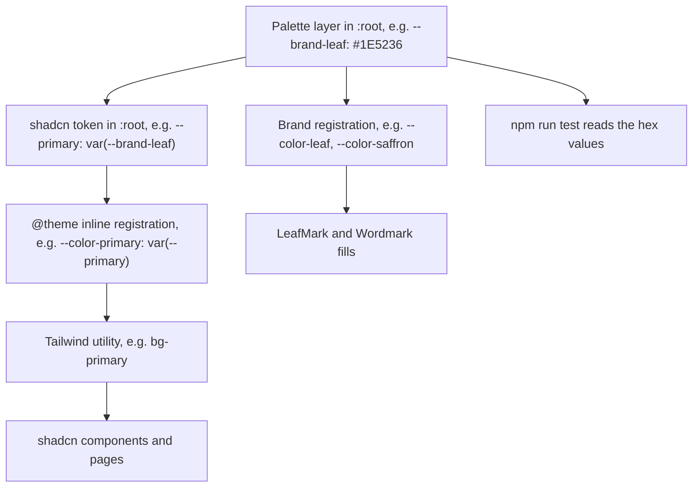
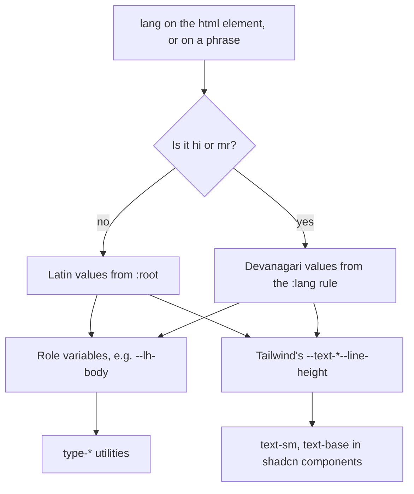

# Design System - Plan

**Task:** `07_design_system` in `document/task/task.md`. `CLAUDE.md` wins over this plan, and the product brief's "Tone and look" and "Rules" sections win over both.

---

## Goal Capsule

- **Objective:** A patient who opens any Sanjivani Clinic page, in English, Hindi or Marathi, sees the calm Herbarium look the owner chose. Text is dark and easy to read, Devanagari shows in the clinic's own fonts with room between lines, and the keyboard focus outline is easy to see. Every later UI task builds from one written, checked set of colours, fonts, sizes and brand files instead of choosing its own.
- **Means:** the decided colours mapped onto shadcn's semantic tokens (KTD1 to KTD3), Martel and Mukta from Fontsource (KTD5), `type-*` utilities with line heights that follow the language (KTD6, KTD7), Astro brand components (KTD9), a contrast check run by `npm run test` (KTD11) and a hand-written `MASTER.md` (KTD12).
- **Authority:** `CLAUDE.md`; then `document/product/brief.md` ("Tone and look", "Rules"); then the task 07 steps in `document/task/task.md`; then the owner's decided values (Key Decisions); then this plan.
- **Stop and ask the owner if:**
  - a decided colour fails its contrast floor in `npm run test` (the planning numbers say none does);
  - `npm view` shows that `@fontsource/martel@5.3.0` or `@fontsource/mukta@5.3.0` is missing, has a licence other than OFL-1.1, has an install script, or ships no Devanagari files;
  - a step needs `shadcn init --force`, `--overwrite`, a style change, a third-party registry, `search.py --persist --force`, a global install, or any npm package other than the two fonts;
  - the favicon can't be turned into a PNG with the `sharp` already in `node_modules`;
  - the work seems to need visible text beyond the wordmark, the placeholder's one line and the specimen's sample strings.
- **Execution profile:** CSS tokens, two Astro components, SVG, two pages and docs. Prove it with the build output, a contrast check that fails loudly, and a look at the specimen page at four widths. There is no test framework, so `npm run test` becomes the contrast check (KTD11).
- **Who finishes:** the main session commits on `07_design_system` and stops at "ready to merge" (CLAUDE.md step 9). ui-engineer may build units and report back, but never touches git. Its brief says the direction is settled, so it skips its usual direction pass.

---

## Product Contract

### Summary

Turn the Herbarium direction into the site's design system. Put the colours on shadcn's tokens, replace Geist with Martel and Mukta, and add a type scale whose line heights grow for Hindi and Marathi. Set the focus, link and motion rules, and add a contrast check anyone can rerun. Build the leaf mark and wordmark for task 08, replace the Astro favicon, show the system on the placeholder page and a hidden specimen page, and write it all down in `design-system/sanjivani-clinic/MASTER.md`.

### Problem Frame

The brief describes the look in words: leaf green, a saffron accent, warm off-white, high contrast, rounded corners, fonts with Devanagari. On 2026-10-27 the owner chose direction A, Herbarium, from three mockups. The mockups live outside the repo, so today the direction exists only as a name in task.md.

The app still wears shadcn's grey `nova` defaults and the Geist font. Geist has no Devanagari letters, so Hindi and Marathi text would fall back to a system font. Some defaults also fail the brief's contrast floor once the brand colours go in: the half-transparent focus ring, the hairline colour reused for form-field edges, and shadcn's default red.

Task 08 (header and layout) can't start until the colours, type and wordmark are settled. Without one written source, every later task would decide them again, and the pages would drift apart.

### Requirements

**Colour**

- R1. The site uses the owner's eight Herbarium colours, each in its decided role (Key Decisions).
- R2. Every text pairing the site uses reaches 4.5:1. Every icon, form-field edge and focus indicator reaches 3:1 against the surfaces it sits on. Pairings that fail are written down as never-use.
- R3. Saffron is only ever decoration, a large shape, or a fill with an ink label. It is never text, a meaningful icon or a focus ring.
- R4. Colours reach shadcn components through its semantic tokens, so a component added later looks right without colour edits.

**Type**

- R5. Headings use Martel (700, 800) and all other text uses Mukta (400, 500, 700), in Latin and Devanagari. Geist is gone.
- R6. A named type scale covers display, section and sub headings, lead, body and small text, with phone and desktop sizes. Text a patient must read is never smaller than 16px.
- R7. Hindi and Marathi text gets taller line heights than English, set by the `lang` of the page or of the phrase, and no letter-spacing.

**Space, shape and interaction**

- R8. Spacing (gutters, section rhythm, reading width) and corners (10px for controls, 14px for containers) are written down, and patient-facing controls are at least 44px tall.
- R9. Keyboard focus is visible on every interactive element at 3:1 or better. Links in text can be told apart from body text without relying on colour. Motion respects "reduce motion".

**Brand files**

- R10. The leaf mark and the wordmark exist as reusable files task 08 can place without redrawing them.
- R11. This task decides whether the favicon and the placeholder page change, and records why.

**Records and checks**

- R12. `design-system/sanjivani-clinic/MASTER.md` records the whole system in ui-ux-pro-max's MASTER.md shape, written by hand, with the real contrast results.
- R13. Line 1 of `src/styles/global.css` stays exactly as it is, and the Tailwind scan checks pass after the rewrite.
- R14. The package changes pass code-reviewer's lockfile check.
- R15. The repo maps, rules and backlog reflect the new files, and a learning doc teaches the task.

### Key Decisions

- **Direction A, Herbarium, with its decided values.** Leaf green #1E5236 (headings, links, primary buttons, focus ring), ink #1B2620 (text), muted #55635A (secondary text), off-white #F6F4EC (page), paper #FFFDF7 (surfaces), sage #E4EBDD (bands), saffron #E3A23A (accents only), border #D9DDD0 (hairlines). Corners are 10 to 14px. The one memorable element is a line-drawn leaf like a pressed herbarium specimen. The wordmark is the leaf mark plus "संजीवनी" in Martel 800 and "Sanjivani Clinic" in Mukta 500. Governs R1, R3, R8, R10. (session-settled: user-directed — chosen over the two other directions shown on 2026-10-27, Sahyadri and Signboard: the owner picked A)
- **Martel and Mukta replace Geist.** Governs R5. (session-settled: user-directed — chosen over keeping Geist: it has no Devanagari letters)
- **MASTER.md is written by hand.** Governs R12. (session-settled: user-directed — chosen over saving ui-ux-pro-max's `--design-system` output with `--persist`: it suggested medical teal, which conflicts with the brief)
- **Left out at the owner's request:** dark mode (backlog 18), page layout and header (task 08), and the task 26 note about pointers to the brief.

### Scope Boundaries

- No header, footer, navigation, language switcher or page layout: that's task 08.
- No translations, per-page `lang` or language routing: that's task 10. This task only writes the `lang` rules those tasks follow (KTD7).
- No shadcn components installed, and no change of shadcn style (Open Questions).
- No dark mode. The `.dark` block stays exactly as shadcn wrote it, and nothing applies `.dark`.
- No font preloading: preload links belong in the layout's `<head>`, which is task 08 (Deferred).
- Considered and not built:
  - **Astro's built-in Fonts API.** It is stable in Astro 7.4 and adds preloads and fallback metrics. But its fallback metrics cover Latin system fonts only, and the owner settled on the Fontsource packages. Revisit if task 09 measures a layout shift when the fonts swap in.
  - **New `--space-*` or `--text-*` tokens.** Tailwind's 4px steps already exist. `cn()` would read custom `text-*` names as colours, and T-shirt `--spacing-*` names would take over `max-w-*`. MASTER.md maps each spacing role to a Tailwind step instead.
  - **Recolouring `--chart-*`.** The site has no charts. Revisit when one is planned.
  - **Status colour tokens (success, warning).** MASTER.md names what they mean. Tasks 13 and 14 add tokens when they need them.

#### Deferred to Follow-Up Work

Backlog notes for `document/task/task.md` (U9):

- **08:** preload one font file per page, chosen by language (Mukta 400 Latin for `en`, Mukta 400 Devanagari for `hi` and `mr`); controls and the language switch at least 44px tall (the board's switch was 36px); `<html lang>` on every page; the owner's answer to the Open Question before the first `shadcn add`.
- **09:** build the large specimen leaf for the hero from MASTER.md's description (Assumption A5).
- **14:** highlighted options in Select and Combobox need a cue that isn't only colour (MASTER.md rule).
- **18:** derive `.dark` from the palette, and add the dark pairs to `npm run test`.
- **21 or 23:** an `apple-touch-icon` and a web manifest made from the favicon; remove the specimen page, or keep it `noindex` and out of the sitemap.
- **The task 26 pointer note:** add a one-line pointer to MASTER.md for the ui-engineer and task-planner agents at the same time.

### Open Questions

- **Deferred to the owner, before task 08's first `shadcn add`:** keep base-nova (32px controls) and size each patient-facing control up to 44px, or switch to a roomier shadcn style such as `maia` (40px+ controls) while no component exists yet? It's a stack choice, and a style change needs `shadcn init --force`, which CLAUDE.md says to ask about first. It doesn't block task 07: MASTER.md states the 44px floor either way (R8).

---

## Planning Contract

### Key Technical Decisions

- KTD1. **Two layers of colour variables, in hex.** A palette layer names each Herbarium colour once: `--brand-leaf`, `--brand-ink`, `--brand-muted`, `--brand-off-white`, `--brand-paper`, `--brand-sage`, `--brand-saffron`, `--brand-hairline`, plus the two in KTD3. shadcn's semantic tokens point at the palette layer. The shadcn skill says to keep hex when the design gives hex.

  The `--brand-` prefix avoids a real trap: the palette's "muted" (#55635A, a text colour) is not shadcn's `--muted` (a background, which is sage here). Brand components read the palette layer, so a local change to `--primary` or `--ring` never recolours the logo.

  | shadcn token | Points at | Why |
  | --- | --- | --- |
  | `--background` / `--foreground` | off-white / ink | page and text, 14.2:1 |
  | `--card`, `--popover` and their `-foreground` | paper / ink | surfaces, 15.4:1 |
  | `--primary` / `--primary-foreground` | leaf / off-white | primary buttons and link-variant text, 8.2:1 |
  | `--secondary` / `--secondary-foreground` | sage / leaf | secondary actions with a green label, as on the board, 7.4:1 |
  | `--muted` / `--muted-foreground` | sage / muted | bands and descriptions; muted text is 5.2:1 on sage, 5.8:1 on the page, 6.2:1 on paper |
  | `--accent` / `--accent-foreground` | sage / ink | shadcn's hover and highlight wash (KTD2) |
  | `--destructive` | error red (KTD3) | error text and borders |
  | `--border` / `--input` | hairline / field edge (KTD3) | dividers, and the edges of form fields |
  | `--ring` | leaf | focus (KTD4) |
  | `--sidebar-*` | the matching main tokens | no off-brand grey if task 08 uses a Sidebar |
  | `--chart-*`, `.dark` | unchanged | unused (Scope Boundaries) |

- KTD2. **Saffron gets its own token, and `--accent` stays a quiet sage.** In shadcn, `--accent` is the hover wash on ghost buttons and the highlighted item in menus and selects, so saffron there would flash on every hover. Saffron is registered as `--color-saffron`, with `--color-saffron-foreground` set to ink (7.1:1). Leaf green on saffron is only 4.1:1, so a saffron fill always takes an ink label. The leaf is registered too (`--color-leaf`), for the mark. MASTER.md allows only `bg-saffron text-saffron-foreground` and the mark's own fills. Every other saffron utility (`text-`, `border-`, `ring-`, `outline-`, `decoration-saffron`) is banned (R3).

- KTD3. **Two colours beyond the decided eight, forced by the contrast floor.** The hairline #D9DDD0 is 1.25:1 on the page. That's fine for dividers, but a form field's edge needs 3:1 (WCAG 1.4.11). shadcn's default red is 4.3:1 on off-white, under 4.5:1. So `--input` gets a darker grey-green "field edge", and `--destructive` a deeper "error red". Their values are in Assumption A7, and `npm run test` confirms them. Reusing the decided muted #55635A as the field edge (5.8:1) would also pass, but it would outline every form field as darkly as secondary text. A lighter edge keeps the calm look and still clears 3:1 on all three surfaces.

- KTD4. **A solid focus outline on everything you can focus.** The leaf ring at 50% opacity blends to about 2.5:1 on the page and 2.4:1 on sage, under 3:1. Two changes:
  1. The base rule's `outline-ring/50` uses the full ring colour instead.
  2. An unlayered `:focus-visible` rule (the shadcn skill's "solid outline with offset") draws a 2px leaf outline with a 2px gap, and turns off the half-transparent ring shadow. It covers links, buttons, form fields, `[role=option]`, menu items, `summary` and `[tabindex]`.

  Unlayered CSS beats every Tailwind layer, so components that set `outline-none` still show the outline. Outlines also survive Windows contrast themes, which drop box-shadow rings. On a green area, the area sets `--ring` to off-white (8.2:1). MASTER.md records both rules.

- KTD5. **Fonts: five Fontsource weight files imported in `global.css`, and Geist removed.** Import `@fontsource/mukta` 400, 500 and 700 and `@fontsource/martel` 700 and 800, just below the three existing imports, so line 1 never moves. Each weight file declares every subset with a `unicode-range`, so the browser downloads a Devanagari file only when the page shows Devanagari in that face. `--font-sans` becomes Mukta and `--font-heading` becomes Martel, each with a system fallback.

  Install `@5.3.0`, the version the owner checked. npm writes `^5.3.0` in `package.json`, the repo's convention (task 06, KTD10), and the lockfile pins 5.3.0 exactly. Uninstall `@fontsource-variable/geist` in the same change, so no unused dependency stays behind. Neither family has italics, so emphasis uses weight (KTD7 turns off fake italics for Devanagari).

- KTD6. **The type scale is six `@utility type-*` classes.** This follows the shadcn skill's rule: `cn()` would read a custom `text-display` as a colour and drop it next to `text-muted-foreground`. Each utility sets the font, weight, size and line height.

  Sizes use rem, so they grow when a patient raises the browser's default font size. Display sizes grow with screen width through a `clamp()` whose middle term is mostly rem. The values come from the board, kept on Bringhurst's classic scale (16, 18, 21, 24, 36, 60):

  | Utility | Font | Phone | Desktop | Latin line height | Devanagari line height |
  | --- | --- | --- | --- | --- | --- |
  | `type-display` | Martel 800 | 36px | 60px | 1.15 | 1.4 |
  | `type-h2` | Martel 700 | 24px | 36px | 1.25 | 1.45 |
  | `type-h3` | Martel 700 | 21px | 21px | 1.3 | 1.45 |
  | `type-lead` | Mukta 400 | 18px | 21px | 1.6 | 1.7 |
  | `type-body` | Mukta 400 | 18px | 18px | 1.6 | 1.75 |
  | `type-small` | Mukta 400 | 16px | 16px | 1.5 | 1.7 |

  The Devanagari values are starting points from W3C and type-design guidance (body 1.6 to 1.8, headings 1.35 to 1.45). Tune them within those ranges on the specimen page, using the test strings in Sources. Headings also get `overflow-wrap: break-word`, because browsers can't hyphenate Hindi or Marathi.

- KTD7. **Line heights follow `lang` through CSS variables.** Each `type-*` utility reads a role variable (`--lh-display`, `--lh-heading`, `--lh-body` and so on) instead of a fixed number. A `:lang(hi), :lang(mr)` rule in `@layer base` gives those variables their Devanagari values. It also redefines Tailwind's own `--text-*--line-height` and `--leading-*` variables, which shadcn components use through `text-sm` and similar classes. Tailwind's defaults for those are not `inline`, so the override works; never move them into `@theme inline`, which would bake the Latin number into each class. The same rule sets `font-synthesis-style: none`. The second diagram in High-Level Technical Design shows the flow. Two more values need care:
  - **The direct line height for plain text goes only where a language starts:** the `<html>` of a Hindi or Marathi page, and an element that switches language itself, such as a `lang="hi"` phrase inside English text. `:lang(hi)` matches every element under `<html lang="hi">`, so a direct value on all of them would override what a link inside a `type-h2` heading inherits from the heading.
  - **`letter-spacing: 0` goes in an unlayered rule**, like KTD4's outline, because any `tracking-*` utility beats a reset in `@layer base`. Letter-spacing breaks the line that joins Devanagari letters.

  MASTER.md writes down the rules tasks 08 and 10 must follow. Every page sets `<html lang>` to `en`, `hi` or `mr` (Marathi is `mr`, never `hi`). Every phrase in another language carries its own `lang`. Every `shadcn add` gets checked for three things: `leading-none` and `truncate`, which clip Devanagari marks whatever the variables say, and `text-xs` or `text-sm` on text a patient reads, which is raised to `text-base` or a `type-*` utility (R6).

- KTD8. **Headings use Martel by default, and links in text are underlined.** A base rule gives `h1` to `h6` the heading font. With `--font-heading` set to Martel, shadcn's CardTitle and DialogTitle use it too. base-nova asks for `font-medium` there, which renders as Martel 700, readable at 16px.

  Plain links in text are underlined before any hover, with the line about 0.2em below the text so it clears the marks under Devanagari letters. Leaf green next to ink is only 1.7:1, and phones have no hover (WCAG 1.4.1). Styled links (buttons, navigation) set their own underline or none.

- KTD9. **Brand files are Astro components with inline SVG.** They are `src/components/brand/LeafMark.astro` and `src/components/brand/Wordmark.astro`. No JavaScript ships. The SVG takes the palette colours from CSS, and the text is live, in Martel and Mukta; an `` of an SVG couldn't load those fonts. The files sit beside `src/components/ui/`, not inside it, because the shadcn CLI owns that folder.
  - **LeafMark:** the board's 40×40 leaf (green body, saffron midrib and four veins). It is decorative by default (`aria-hidden`, not focusable). A `forced-colors` rule draws it in system colours, so it stays a leaf in Windows contrast themes.
  - **Wordmark:** the mark plus two lines. "संजीवनी" is in Martel 800 in leaf green, with its own `lang` (A6) and its own line height. "Sanjivani Clinic" is in Mukta 500 in ink, with `lang="en"`. Both lines set fixed line heights inside the component, so the lockup is the same height on English, Hindi and Marathi pages and the header doesn't jump when the language changes. Sizes are in `em`, so the caller scales the whole lockup with one font size. It renders a plain inline container: the caller wraps it in an `<h1>`, or in task 08's home link. Both lines stay in the accessible name, matching what's visible (WCAG 2.5.3), so there's no `aria-label`.

- KTD10. **The favicon is a simplified mark on a paper tile.** At 16px the side veins smear, so the favicon keeps only the leaf and its midrib. The tile matters: leaf green on a dark tab bar is 1.3 to 1.8:1, while the paper tile is at least 11.9:1. `public/favicon.svg` is the only brand file with fixed hex colours, because a favicon can't read the page's CSS. `public/favicon.ico` is made again from it as a 32×32 PNG, like Astro's original. A one-off command does this with the `sharp` that Astro already installed; the command is recorded in the learning doc, not committed as a script. Whichever icon a browser picks, it shows the leaf.

- KTD11. **The contrast check is `npm run test`.** It is a Node script with no dependencies, `scripts/check-contrast.mjs`. It:
  - reads the palette's hex values from `:root` in `global.css`, and follows one level of `var()`;
  - checks a named table of pairs: text pairs at 4.5:1, and other parts (focus outline, field edge, icons) at 3:1. A see-through fill such as `bg-destructive/10` is blended over its surface first;
  - checks that the never-use pairs do fail (saffron text on off-white, leaf text on saffron), so a broken calculation can't pass;
  - includes black on white, which must print 21:1;
  - prints every pair with its ratio and the number of pairs, and exits with an error if any check fails.

  code-reviewer's command list allows `npm run test` but not `node` or `python3`, so this is the only way the reviewer can rerun the numbers. The script's table is the one place that decides which pairs are checked; MASTER.md pastes its output.

- KTD12. **MASTER.md keeps the template's headings and holds our own content.** Keep ui-ux-pro-max's section order: Global Rules (Color Palette, Typography, Spacing Variables, Shadow Depths), Component Specs, Style Guidelines, Motion, Anti-Patterns, Pre-Delivery Checklist. Fix the template's slips:
  - the LOGIC line names `design-system/sanjivani-clinic/pages/`, not `design-system/pages/`;
  - the colour table's third column holds the real `global.css` variables, and "Accent" never means saffron;
  - Component Specs map each part to shadcn variants and tokens, instead of the template's raw CSS.

  Add our own subsections: Languages and Devanagari (KTD7's rules), Brand marks, Focus and touch targets, and Status meanings. The header says the file was written by hand on 2026-10-27 in task 07 and must never be regenerated with `--persist --force`. There's no empty `pages/` folder, since git can't hold one. The file is Markdown only and lives outside `src/`, so lint and the Tailwind scan skip it.

- KTD13. **A hidden specimen page makes the system checkable.** Tailwind builds only the classes that `src/` uses. So a passing build says nothing about a `type-*` utility or `bg-saffron` that no page uses yet. `src/pages/specimen.astro` is marked `noindex` and linked from nowhere. It shows:
  - every `type-*` role, in English, Hindi and Marathi paragraphs with `lang`;
  - a link in body text and one in muted text;
  - a plain HTML button, a text field and an error line, styled only with tokens;
  - a saffron fill with an ink label, a sage band, a paper card and a green area;
  - the wordmark at two sizes.

  The owner uses it to judge the system, and the build checks look for its classes.

### High-Level Technical Design

How a colour travels from the palette to a component:



How a line height follows the language (KTD7):



### Output Structure

```text
design-system/sanjivani-clinic/MASTER.md     new
scripts/check-contrast.mjs                   new
src/components/brand/LeafMark.astro          new
src/components/brand/Wordmark.astro          new
src/pages/specimen.astro                     new
src/pages/index.astro                        changed
src/styles/global.css                        changed
public/favicon.svg, public/favicon.ico       replaced
package.json, package-lock.json              changed
eslint.config.js                             changed (Node globals for scripts/)
```

### Assumptions

These are bets made without the owner, since this planning run asked no questions. The owner confirms or corrects them when reviewing the pull request.

- A1. **The favicon changes in this task** (KTD10). Astro's logo is the wrong brand, and the change is cheap now.
- A2. **The placeholder page changes a little.** The `<h1>` holds the wordmark, the existing line uses `type-body`, and a padded wrapper keeps both off the screen edge. It stays in English, with no header or footer. Its `type-body` class becomes the positive control for the Tailwind scan check, replacing `.text-3xl`.
- A3. **The specimen page is committed** (KTD13). Before launch it is removed, or kept hidden (Deferred, 21 or 23).
- A4. **The contrast check becomes the `test` script** (KTD11). It's the first file in a new `scripts/` folder.
- A5. **The large specimen leaf moves to task 09.** The brief makes it the one memorable element, but the request named only the mark and the wordmark as files, and the leaf belongs in task 09's hero. MASTER.md describes it: the board's 300×390 drawing, with a green outline and veins and a saffron midrib. It is decorative, hidden from screen readers, and its thin lines must stay visible when it's drawn small.
- A6. **"संजीवनी" carries `lang="mr"`.** Marathi is Pune's language, the spelling is the same in Hindi, and the `lang` makes a screen reader use a Devanagari voice. The same wordmark appears on all three language pages.
- A7. **The two added colours:** field edge #76837A (3.60:1 on the page, 3.90:1 on paper, 3.25:1 on sage) and error red #B42318 (5.97:1 on the page, 5.39:1 on sage, 5.07:1 on its own 10% tint). These were worked out during planning; `npm run test` is the real check.
- A8. **Highlighted options** (sage on paper is only 1.2:1) get a cue that isn't only colour, such as an inset outline, when the first menu or select is installed. This task writes that rule into MASTER.md and adds no CSS for components that don't exist yet.
- A9. **Body text is 18px at every width**, as on the board. It helps older readers, and Devanagari looks smaller than Latin at the same size.
- A10. **Board details not carried over:** the softer lead-text colour #3A463F (ink is used instead), the two rule colours #C5CCBB and #C5D2BD (the hairline is used instead), the hover green #163E29 (the underline and shadcn's `primary/90` are used instead), and the 36px language switch (44px in task 08).
- A11. **Two small global rules.** A `prefers-reduced-motion` rule cuts CSS animation and transition times to almost zero, because shadcn's dialogs animate through `tw-animate-css`, which GSAP's `matchMedia` doesn't cover. And `:root` gets `color-scheme: only light` until task 18, so Chrome on Android doesn't auto-darken the brand colours. Add the second rule only if Chrome's documentation confirms it at work time, and record the page.
- A12. **Facts about the 5.3.0 packages** (file names, family names, no install scripts, OFL-1.1, Devanagari files) come from the repo's font data and from memory. Planning couldn't run `npm view` or open web pages. U1 checks them first.

### Risks

| Risk | Mitigation |
| --- | --- |
| Devanagari font files are the heaviest part of a page. Each weight used adds one, and the wordmark loads Martel 800 Devanagari on every English page | Record what an English page and a Hindi or Marathi page each download (Verification Contract), and give both totals to the owner at "ready to merge": weights are their call |
| Rewriting `global.css` silently drops line 1's `source("../")` or a shadcn variable | The Tailwind solution doc's checks, plus the whole-file token comparison (Verification Contract) |
| ui-engineer re-plans the palette in its usual direction pass | Its brief says the direction is settled and names this plan |
| A web font is slow or blocked | `font-display: swap` shows system fonts first, and Android's Noto Sans Devanagari is readable. The specimen is checked once with the fonts blocked |
| The task is big for a 15-minute review | One idea per commit, in unit order, so the reviewer can read it commit by commit |

### Sources

- Past lessons:
  - `document/solutions/best-practices/tailwind-source-limit-in-global-css.md`: the line 1 and canary checks (R13).
  - `document/solutions/workflow-issues/check-whole-file-not-diff-window.md`: compare whole files, and pair every list with a count (Verification Contract).
  - `document/solutions/workflow-issues/update-learning-doc-after-later-steps.md`: U10 and the review steps.
  - `document/solutions/workflow-issues/check-new-steps-against-claude-md.md`: task 07 already has 8 steps, the task-planner limit, so U9 rewords the Build step instead of adding one.
  - `document/solutions/workflow-issues/check-legal-rules-against-official-sources.md`: check package facts on the npm registry and record the date (U1).
- `.claude/skills/shadcn/customization.md` and `design-system.md`: token roles, `@utility type-*`, the solid outline recipe, keeping hex.
- `.claude/skills/ui-ux-pro-max/scripts/design_system.py` (`format_master_md`): the MASTER.md headings.
- `.claude/skills/frontend-design/SKILL.md`: a clear type scale, one memorable element, the generic looks to avoid. It also warns that cream plus a serif display is a common generated look. The brief asks for warm off-white, and the brief wins; the herbarium leaf and the Devanagari wordmark are what make the site this clinic's.
- Devanagari test strings for the specimen: "त्वचा और बालों की समस्याओं का निदान और उपचार" and "द्ध ह्म ङ्क ट्ट क्र" (Hindi); "पुण्यात त्वचा आणि केसांची काळजी" and "सकाळी १० ते दुपारी २" (Marathi). They cover marks above and below the line, stacked letters and Devanagari digits. They are sample text for checking type, not site copy.
- Commit `5738c10`: package files committed with the config that uses them.
- WCAG 2.2 (w3.org/TR/WCAG22): 1.4.1 Use of Color, 1.4.3 Contrast (Minimum), 1.4.4 Resize Text, 1.4.11 Non-text Contrast, 2.4.7 Focus Visible, 2.5.3 Label in Name, 3.1.2 Language of Parts.

---

## Implementation Units

| U-ID | Title | Main files | Depends on |
| --- | --- | --- | --- |
| U1 | Fonts | `package.json`, `package-lock.json`, `src/styles/global.css` | none |
| U2 | Colour tokens | `src/styles/global.css` | U1 |
| U3 | Contrast check | `scripts/check-contrast.mjs`, `package.json`, `eslint.config.js` | U2 |
| U4 | Type scale and language line heights | `src/styles/global.css` | U1 |
| U5 | Focus, link and motion rules | `src/styles/global.css` | U2, U3 |
| U6 | Leaf mark, wordmark and favicon | `src/components/brand/`, `public/favicon.*` | U2, U4 |
| U7 | Placeholder and specimen pages | `src/pages/index.astro`, `src/pages/specimen.astro` | U4, U5, U6 |
| U8 | MASTER.md | `design-system/sanjivani-clinic/MASTER.md` | U7 |
| U9 | Repo docs and backlog notes | `CLAUDE.md`, `readme.md`, `document/skills/skills.md`, `document/task/task.md`, the Tailwind solution doc | U8 |
| U10 | Learning doc | `document/learning/07_design_system.md` | U9 |

### U1. Fonts

- **Goal:** Martel and Mukta are installed and are the site's heading and text fonts. Geist is gone.
- **Requirements:** R5, R13, R14
- **Dependencies:** none
- **Files:** `package.json`, `package-lock.json`, `src/styles/global.css`
- **Approach:**
  1. Run `npm view` for both packages at 5.3.0 (version, licence, scripts). Record the output and the date for the learning doc, and stop on any surprise (Goal Capsule).
  2. Install both at 5.3.0, then confirm each package's `files/` folder holds Devanagari files.
  3. Replace the Geist import with the five weight imports, and set `--font-sans` and `--font-heading` (KTD5). Line 1 doesn't move.
  4. Uninstall `@fontsource-variable/geist`.
  5. Commit both package files with `global.css` in one commit, the repo's convention for a package and the config that uses it.
- **Patterns to follow:** commit `5738c10`. Never install with `--force` or `--legacy-peer-deps`.
- **Test scenarios:**
  - After a fresh build, the built CSS declares `@font-face` rules for Martel and Mukta and has no Geist.
  - `dist/_astro/` holds a Devanagari woff2 file for each of the five weights.
  - The lockfile's four counts (code-reviewer step 4) are equal, and its install-script names are the same as on `main`.
- **Verification:** the placeholder's text renders in Mukta (the browser's rendered-fonts panel), and `npm ls` shows both fonts at 5.3.0 and no Geist.

### U2. Colour tokens

- **Goal:** `global.css` holds the palette layer and maps every shadcn token the site uses onto it.
- **Requirements:** R1, R3, R4
- **Dependencies:** U1
- **Files:** `src/styles/global.css`
- **Approach:**
  1. Add the palette variables to `:root` (KTD1, KTD3, A7).
  2. Point the shadcn tokens at them as KTD1's table says, and the `--sidebar-*` tokens at their main twins.
  3. Register `--color-saffron`, `--color-saffron-foreground` and `--color-leaf` in `@theme inline` (KTD2).
  4. Leave `.dark`, `--chart-*` and `--radius` alone.
- **Test scenarios:**
  - Every token name on `main` is still defined on the branch (a whole-file comparison that prints both counts).
  - Every `var(--x)` in `@theme inline` has a definition in `:root`.
  - `git diff main` changes no line inside `.dark`.
- **Verification:** the placeholder's background is off-white and its text is ink.

### U3. Contrast check

- **Goal:** `npm run test` proves every pairing in R2 and fails when one breaks.
- **Requirements:** R2, R3
- **Dependencies:** U2
- **Files:** `scripts/check-contrast.mjs`, `package.json` (a `test` script), `eslint.config.js`
- **Approach:** build the KTD11 script.
  - ESLint's recommended rules flag `process` and `console` as undefined in a `.mjs` file. Add one `eslint.config.js` block for `scripts/` that declares those two names as read-only globals, written inline; the `globals` package would be a third new dependency (Goal Capsule).
  - Leave `// @ts-check` off the script. No Node type definitions are installed, so `npm run typecheck` would fail on it.

  The script's table covers at least:
  - ink, muted and leaf text on off-white, paper and sage;
  - off-white text on leaf, and ink on saffron;
  - the leaf outline on off-white, paper and sage, and the off-white outline on leaf;
  - the field edge on off-white, paper and sage;
  - error red on off-white, on sage and on its own 10% tint.

  Never-use pairs that must fail: saffron text on off-white, leaf text on saffron, and the hairline as a field edge.
- **Execution note:** write the table and run it before U5, so the focus and field-edge numbers are known before those rules are written.
- **Test scenarios:**
  - On the branch, every required pair passes, every never-use pair fails as expected, and the exit code is 0.
  - Changing `--brand-muted` to a lighter grey such as #8A958C for a moment makes the run exit with an error and name the failing pairs. Change it back before committing.
  - The printed number of pairs equals the number of rows in the table.
  - Black on white prints 21.00.
- **Verification:** `npm run lint` and `npm run typecheck` pass with the script in place, and the script's numbers match A7's to two decimals.

### U4. Type scale and language line heights

- **Goal:** six `type-*` utilities, headings in Martel, and line heights that grow for Hindi and Marathi.
- **Requirements:** R6, R7
- **Dependencies:** U1
- **Files:** `src/styles/global.css`
- **Approach:**
  1. Add the role variables and the six utilities (KTD6).
  2. Add the `:lang(hi), :lang(mr)` rules (KTD7) and the heading rule (KTD8).
- **Execution note:** the test scenarios below need a page to render on, so they run on the specimen in U7, which also tunes the Devanagari values. Before then, prove the unit with the build: it passes, and the `:lang` rules appear in the built CSS.
- **Technical design:** directional only. A utility reads a role variable; for example, `type-body` takes its line height from `--lh-body`. `:root` sets `--lh-body` to the Latin number, and the `:lang` rule sets it to the Devanagari one.
- **Test scenarios:**
  - An English `type-body` paragraph has a line height of 1.6 times its font size.
  - The same paragraph inside `lang="hi"` has 1.75 times, and inside `lang="mr"` the same.
  - A `text-sm` element inside `lang="hi"` gets the Devanagari value for `text-sm`, which shows that shadcn-style classes follow too.
  - An inline `<span lang="hi">` inside an English paragraph isn't clipped and doesn't touch the next line.
  - A link inside a Hindi `type-h2` heading keeps the heading's 1.45 line height.
  - A `tracking-tight` element inside `lang="hi"` has a letter-spacing of 0.
  - At 375px and 1440px, no Devanagari line on the specimen has marks touching the line above or below.
  - The longest heading word on the specimen fits a 320px-wide screen without sideways scrolling.
- **Verification:** lint, typecheck and build pass. The six `type-*` selectors reach the built CSS only once a page uses them, so U7 checks them.

### U5. Focus, link and motion rules

- **Goal:** focus you can always see, links you can spot without colour, and CSS motion that respects "reduce motion".
- **Requirements:** R9
- **Dependencies:** U2, U3
- **Files:** `src/styles/global.css`
- **Approach:** add the KTD4 outline, the KTD8 link underline and the A11 rules. Commit them separately from U4, since they're a different idea.
- **Execution note:** the test scenarios run on the specimen in U7. Before then, the build passes and the outline rule appears in the built CSS.
- **Test scenarios:**
  - Tabbing through the specimen shows a solid leaf outline with a gap on the link, the button and the text field.
  - On the specimen's green area, the outline is off-white.
  - With forced colours emulated in the browser's developer tools, the focused element still shows an outline.
  - A plain link in body text is underlined before any hover; a link styled as a button is not.
  - With "reduce motion" emulated, a CSS transition on the specimen finishes at once.
- **Verification:** U3's outline pairs pass, and no element on the specimen loses its visible focus.

### U6. Leaf mark, wordmark and favicon

- **Goal:** the brand files task 08 places, and a leaf in the browser tab.
- **Requirements:** R10, R11, R3
- **Dependencies:** U2, U4
- **Files:** `src/components/brand/LeafMark.astro`, `src/components/brand/Wordmark.astro`, `public/favicon.svg`, `public/favicon.ico`
- **Approach:**
  1. Build LeafMark and Wordmark as KTD9 says, from the board's 40×40 drawing (MASTER.md records it, U8). One commit each.
  2. Make the favicon as KTD10 says, and make the `.ico` from the new SVG. Commit both formats together, since one is made from the other.
  3. If the owner is available once the specimen exists (U7), show them the mark. Otherwise, flag it for their review.
- **Execution note:** the test scenarios run on the pages in U7. Before then, lint, typecheck and build pass.
- **Test scenarios:**
  - A screen reader reads the wordmark as "संजीवनी Sanjivani Clinic", uses a Devanagari voice for the first word, and skips the leaf.
  - The wordmark is the same height inside `lang="en"`, `lang="hi"` and `lang="mr"`.
  - With forced colours emulated, the mark is still a visible leaf.
  - The wordmark scales as one piece when its container's font size changes, and fits at 320px without overflowing.
  - The favicon shows the leaf on a light tab bar and on a dark one.
  - `file public/favicon.ico` reports a 32 × 32 image.
- **Verification:** lint, typecheck and build pass with both components in place. The saffron search runs in U7, once the specimen gives it a `bg-saffron` to find.

### U7. Placeholder and specimen pages

- **Goal:** the owner can see the system working, and every utility it defines gets built.
- **Requirements:** R11, R13, R2, R7, R9
- **Dependencies:** U4, U5, U6
- **Files:** `src/pages/index.astro`, `src/pages/specimen.astro`, and `src/styles/global.css` for the line-height tuning only
- **Approach:**
  1. Change the placeholder as A2 says. Keep `lang="en"`, the title and both favicon links.
  2. Build the specimen as KTD13 says, with `<meta name="robots" content="noindex">` and the test strings from Sources.
  3. Run the test scenarios of U4, U5 and U6 on the specimen. Tune the Devanagari line heights within KTD6's ranges while looking at it, and commit the tuning on its own. MASTER.md records the final numbers (U8).
  4. Commit each page separately.
- **Test scenarios:**
  - Each of the six `type-*` selectors appears in the fresh built CSS.
  - A search of `src/` finds no banned saffron utility (KTD2), and finds `bg-saffron` at least once, which shows the search works.
  - After a fresh build, `dist/index.html` contains "संजीवनी" and "Sanjivani Clinic", and `dist/specimen/index.html` has the `noindex` meta tag.
  - The Tailwind scan checks pass with `type-body` as the positive control (R13).
  - At 375, 768, 1024 and 1440px, neither page scrolls sideways. At 320px and at 200% text zoom, the specimen still reads.
  - With woff2 requests blocked, the Hindi specimen still reads in system fonts, with nothing clipped.
- **Verification:** every build check in the Verification Contract passes on a fresh `dist/`.

### U8. MASTER.md

- **Goal:** one file holds every decision a later UI task needs.
- **Requirements:** R12, R8, R3, R7, R9
- **Dependencies:** U7
- **Files:** `design-system/sanjivani-clinic/MASTER.md`
- **Approach:** follow KTD12's shape, with this content:
  - **Color Palette:** palette names, hex values and tokens (KTD1), the saffron rules (KTD2) and the never-use list, with the real `npm run test` output pasted in.
  - **Typography:** the KTD6 table with the tuned numbers, the font import lines, and the rules on italics, letter-spacing and the weights that are loaded.
  - **Spacing Variables:** the template's seven `--space-*` rows mapped to Tailwind steps (4, 8, 16, 24, 32, 48 and 64px are steps 1, 2, 4, 6, 8, 12 and 16). Page gutters are 16px on phones and 64px on desktop. Sections are 48px apart on phones and 72px on desktop. Body text is at most about 65 characters wide.
  - **Shadow Depths:** no shadow on cards. Hairlines and sage bands separate content. Floating layers keep shadcn's own shadow.
  - **Component Specs:**
    - Buttons: `default` is leaf with an off-white label; `outline` and `secondary` have a leaf label; saffron only as `bg-saffron text-saffron-foreground`. All `min-h-11`, 10px corners, Mukta 700.
    - Cards: paper, hairline border, 14px corners.
    - Inputs: paper, field-edge border, 10px corners, 18px text so iPhones don't zoom in, `min-h-11`.
    - Modals: paper, 14px corners, Martel title.
  - **Style Guidelines:** Herbarium. The page pattern for task 09 is a headline beside the specimen leaf, then the band with timings, address and doctor. Include the specimen leaf's description (A5).
  - **Motion:** at most one calm moment when a page loads (task 09), lasting 150 to 300ms. GSAP runs through `useGSAP` and `gsap.matchMedia()`, with a still version for "reduce motion".
  - **Anti-Patterns:**
    - saffron text or icons, and leaf text on saffron;
    - letter-spacing or italics on Devanagari;
    - patient-facing text under 16px;
    - `leading-none` or `truncate` on Devanagari;
    - a shadow on every card, all-caps labels, and arrows added to button text;
    - raw hex values in components;
    - any word banned by the brief's rule 2, even in sample text.
  - **Pre-Delivery Checklist:** the template's items, plus: all three scripts render in Martel and Mukta; Devanagari line heights checked; 44px targets; `npm run test` passes; `lang` set on the page and on phrases; each added shadcn component checked for `leading-none`, `truncate`, `text-xs` and `text-sm` (KTD7).
  - **Our subsections:** Languages and Devanagari; Brand marks (the files, their sizes, and keeping the favicon in step with LeafMark by hand); Focus and touch targets; Status meanings (success is leaf on sage; attention is a saffron fill with ink text and an icon; error is destructive; never colour alone).
- **Patterns to follow:** check every rule against CLAUDE.md before committing (`check-new-steps-against-claude-md.md`). ui-engineer treats MASTER.md's decisions as binding.
- **Test expectation:** none -- documentation. U3's output and the checks in U4 to U7 are its evidence.
- **Verification:** each of R1 to R9 has a section that states it, and every number in the file matches `global.css` or the script's output.

### U9. Repo docs and backlog notes

- **Goal:** the repo's maps, rules and backlog describe what now exists.
- **Requirements:** R15
- **Dependencies:** U8
- **Files:** `CLAUDE.md`, `readme.md`, `document/skills/skills.md`, `document/task/task.md`, `document/solutions/best-practices/tailwind-source-limit-in-global-css.md`
- **Approach:** one commit per file.
  - **`CLAUDE.md`:**
    - Repo map: new rows for `design-system/` and `scripts/`, and `components/brand/` added to the `src/` row.
    - Commands: `npm run test` (the contrast check).
    - Skills rules: one line saying MASTER.md is hand-written, is read before UI work, is never regenerated with `--persist --force`, and that the brief wins over it.
  - **`readme.md`:** the same repo-map rows, and `npm run test` in its commands.
  - **`skills.md`:** where it says MASTER.md is written by `--persist`, add that this project's copy is written by hand.
  - **`task.md`:**
    - Link this plan from the Plan step.
    - Reword the Build step to name the favicon, the two pages and the contrast check, without adding a step (8 is the limit).
    - Add the Deferred backlog notes.
  - **The Tailwind solution doc:** replace the `.text-3xl` positive control with `type-body` (A2), so the lesson stays true.
  - Check each new rule against CLAUDE.md's Task workflow, Git rules and Agents sections before committing.
- **Test expectation:** none -- docs.
- **Verification:** every new folder appears in both repo maps, and task 07's Merge step in task.md is still followed by a blank line.

### U10. Learning doc

- **Goal:** the owner can learn from the task without having watched it.
- **Requirements:** R15
- **Dependencies:** U9
- **Files:** `document/learning/07_design_system.md`, and its link in task.md's Tasks table
- **Approach:**
  - learning-doc-writer writes it from `document/learning/TEMPLATE.md`, with the header set to `In progress`.
  - New terms: design token, semantic token, palette layer, contrast ratio, WCAG, font subset and `unicode-range`, `font-display: swap`, the Devanagari headline and its marks, `:lang()`, `@utility`, `:focus-visible`, forced colours, favicon.
  - Decisions worth knowing: KTD1 (the two layers and the "muted" trap), KTD2, KTD4, KTD7 and KTD11.
  - Real output only: `npm view`, `npm run test`, the build checks and the woff2 sizes.
  - Say how the widths, focus and forced colours were checked, and by whom. If no browser tool was available, say so, and record what the owner saw.
  - Try it yourself: change one palette value and watch `npm run test` fail.
  - Every placeholder starts with "Pending". Update the doc after ce-code-review, after each code-reviewer pass and after compound (`update-learning-doc-after-later-steps.md`).
- **Test expectation:** none -- prose. code-reviewer checks it.
- **Verification:** it answers Why, What and How, and the commands it shows print the same output when run again.

---

## Verification Contract

Run these after U7, again after U9, and again after the review fixes. Paste the real output into the learning doc. Build fresh first: the old `dist/` still holds the Geist files and proves nothing.

| Check | Passes when |
| --- | --- |
| `npm run lint`, `npm run typecheck`, `npm run build` | all three pass |
| `npm run test` | exit code 0; every required pair passes; every never-use pair fails; the pair count matches the table |
| Line 1 and the Tailwind scan (`document/solutions/best-practices/tailwind-source-limit-in-global-css.md`) | `head -1` prints the `source("../")` import; `type-body` is found in the built CSS; both canaries are absent; both halves of the canary check hold |
| `type-*` utilities built | each of the six selectors appears in the built CSS |
| Fonts built | `@font-face` rules for Martel and Mukta, no Geist; a Devanagari woff2 file for each of the five weights in `dist/_astro/`; the woff2 bytes an English page and a Hindi or Marathi page download, totalled and recorded |
| Tokens kept | every token name on `main` still defined on the branch, with both counts printed; every `@theme inline` reference defined; `.dark` unchanged |
| Saffron use | no banned saffron utility in `src/`; `bg-saffron` found at least once |
| Lockfile (code-reviewer step 4) | four equal counts above 0; the same install-script names on both sides; `package.json` adds exactly the two fonts and removes Geist |
| In a browser: 375, 768, 1024 and 1440px, plus 320px and 200% zoom | both pages have no sideways scroll; Devanagari isn't clipped; focus is visible from the keyboard; forced colours, reduced motion and blocked fonts each tried once. Record who checked and how |
| `git status --short` | clean, with no temporary test edit left |
| ce-code-review, then code-reviewer with the CLAUDE.md step 7 snapshot | the snapshots match; every must-fix is fixed; the verdict is in the learning doc |

---

## Definition of Done

- U1 to U10 are committed on `07_design_system`, one idea per commit, with code, docs and tracker changes in separate commits.
- Every Verification Contract check passes, with its real output in the learning doc.
- task.md links this plan from task 07's Plan step, and every step is ticked except Review, Compound and Merge until each really happens.
- `.claude/`, `skills-lock.json`, `components.json` and the `.dark` block have no diff against `main`.
- No temporary edits are left in the tree (the U3 failure test, any scratch page).
- The compound question is asked and answered in the learning doc.
- The final code-reviewer pass says "Ready to merge", and the owner merges the pull request (CLAUDE.md step 9).
